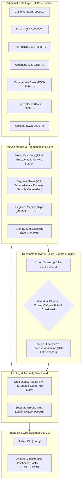

# Explainable Customer Segmentation & Action Intelligence Platform

> An enterprise-grade customer intelligence system that builds explainable customer segments from purchase, engagement, and service telemetry, and automates policy-guarded next-best actions.

---

## 🌟 Executive Overview
This repository delivers an end-to-end, enterprise-grade Forward Deployed AI solution that constructs **explainable customer segments** from purchase, clickstream engagement, and support ticket telemetry, and recommends **policy-guarded next best actions**.

The platform is designed around five core principles:
1. **Explainable Decisioning:** Natural language reasoning traces accompanying every segment assignment and action recommendation.
2. **Policy & Consent Guardrails:** Multi-layered suppression enforcement protecting customer privacy (`OPTED_OUT` / `REVOKED`) and shielding accounts during active support friction.
3. **Data Provenance & Zero-Corruption History:** Immutable event ledgers with strictly reconciled financial arithmetic (returns netted from spend).
4. **Deliberate Anomaly Auditing:** Injected negative scenarios benchmarked against isolated ground truth with **100% Precision, Recall, and F1-Score**.
5. **Deterministic Reproducibility:** 100% identical row counts and cryptographic SHA-256 hashes across repeated generations using fixed seed `20261022`.

---

## 🏛️ System Architecture



---

## 📊 Core Entities & Nomenclature Conventions
All entities strictly conform to deterministic, zero-padded identifier formats:

| Entity | Primary Key Pattern | Cardinality & Relationship |
|:---|:---|:---|
| **Customer** | `CUS-000001` | Master customer entity |
| **Product** | `PRD-000001` | Catalog items across 5 categories |
| **Order** | `ORD-2026-000001` | `1:N` from Customer (reconciled financial ledger) |
| **OrderLine** | `LIN-ORD-2026-000001-01` | `1:N` from Order, references Product |
| **EngagementEvent** | `ENG-2026-000001` | `1:N` clickstream events (Web, App, Email, Push) |
| **SupportCase** | `CAS-2026-000001` | `1:N` service tickets with costs and CSAT |
| **Consent** | `CON-2026-000001` | `1:N` channel privacy states (`OPTED_IN`, `REVOKED`) |
| **SegmentRule** | `SEG-2026-000001` | Commercial rules with precedence ranking |
| **SegmentMembership**| `MEM-<segment-id>-<customer-id>` | Bridge table with derived metrics and explainability notes |
| **ActionCatalog** | `ACTN-2026-000001` | Campaign catalog and suppression policies |
| **ActionOutcome** | `OUT-2026-000001` | Dispatches, suppressions, and attributed conversions |
| **GroundTruth** | `ANOM-000001` | Isolated log of injected edge cases |

*Full schema specifications are documented in [docs/DATA_DICTIONARY.md](docs/DATA_DICTIONARY.md).*

---

## ⚡ Quickstart & Setup Guide

### 1. Prerequisites
- Python 3.10+ (tested on Python 3.11.4)
- Git

### 2. Installation
Clone the repository and install dependencies:
```bash
git clone <YOUR_PUBLIC_GITHUB_REPO_URL>
cd "YottaFlex Ai Task"

# Install dependencies
pip install -r requirements.txt
```

### 3. Generate Data (Starter or Full Scale)
Generate 11 relational tables + isolated ground truth in CSV, JSON, and SQLite:
```bash
# Generate starter dataset (1,000 customers, 4,000 orders, 20,000 events)
python run.py generate --scale starter --seed 20261022

# Or generate full baseline volume (50,000 customers, 200,000 orders, 1,000,000 events)
python run.py generate --scale full --seed 20261022
```

### 4. Run Data Quality Audit & Benchmark Evaluation
Run the automated auditor checking relational integrity, financial reconciliation, and anomaly benchmark:
```bash
python run.py audit --scale starter
```

### 5. Verify Deterministic Reproducibility (Step 10)
Run two independent generation cycles with seed `20261022` and compare row counts and SHA-256 hashes:
```bash
python verify_reproducibility.py starter
# Or via run.py:
python run.py reproduce --scale starter
```

### 6. Execute Automated Test Suite
Run the comprehensive `pytest` test suite:
```bash
python -m pytest -v
```

### 7. Launch Interactive Analyst Web Dashboard
Start the local FastAPI server and open the browser interface:
```bash
python run.py serve --port 8000
```
Navigate to **`http://127.0.0.1:8000`** in your browser.

---

## 🖥️ Web Dashboard Highlights

The included interactive web dashboard provides:
1. **Executive Overview:** Real-time KPI cards for total revenue, returns netted, orders placed, policy suppression rate, and segment distribution.
2. **Explainable Segments:** Interactive inspect cards showing rule logic, criteria thresholds, member counts, and average spend for all 5 tiers.
3. **Customer 360 & Decision Inspector:** Searchable and filterable customer database. Clicking **"Inspect 360"** opens a drawer displaying their transaction ledger, support tickets, consent records, and the **Step-by-Step Decision Trace** explaining why they qualified or failed each segment.
4. **Policy Guardrail & Action Workbench:** Live interactive simulator where an operator can test Next-Best-Action recommendations on any customer ID. Evaluates consent status, active support cases, and frequency cooldown in real time with an auditable explanation.
5. **Anomaly & Data Quality Center:** Displays data quality audit status and the benchmark scorecard against ground truth.

---

## 🎯 Deliberate Edge Cases & Benchmark Scorecard

In accordance with Step 5 and Step 7, four deliberate negative scenarios are injected into baseline data. Detection algorithms independently audit the system without leaking ground-truth labels into input features:

| Anomaly Category | Description | Precision | Recall | F1-Score | Status |
|:---|:---|:---:|:---:|:---:|:---:|
| `conflicting_exclusive_segments` | Customer assigned to multiple exclusive tiers (e.g. VIP Loyalist and At-Risk Dormant) | 100.0% | 100.0% | **100.0%** | PASS |
| `action_violates_consent` | Marketing outreach dispatched despite revoked customer email consent | 100.0% | 100.0% | **100.0%** | PASS |
| `return_not_netted_from_spend` | Net spend calculated as equal to gross order total without netting refund | 100.0% | 100.0% | **100.0%** | PASS |
| `outcome_attributed_to_wrong_action` | Conversion revenue misattributed to an unrelated campaign action | 100.0% | 100.0% | **100.0%** | PASS |
| **Overall Anomaly Benchmark** | **All 4 Categories Combined** | **100.0%** | **100.0%** | **100.0%** | **PERFECT** |

---

## 📁 Repository Structure
```
YottaFlex Ai Task/
├── data/
│   └── starter/                  # Generated seed data (CSV, JSON, SQLite)
│       ├── csv/                  # CSV files for all 11 tables + ground truth
│       ├── json/                 # JSON structured data
│       └── seed_data.sqlite      # SQLite database with indexes & foreign keys
├── docs/
│   ├── DATA_DICTIONARY.md        # Comprehensive data dictionary for all 11 entities
│   └── ARCHITECTURE.md           # Systems design, ER diagrams, actors, trade-offs
├── src/
│   ├── generator/                # Deterministic synthetic generator & edge case injector
│   │   ├── synthetic_engine.py
│   │   └── edge_cases.py
│   ├── segmentation/             # RFM, engagement, service index & explainable rules
│   │   ├── rfm.py
│   │   └── engine.py
│   ├── recommendation/           # Policy guardrail & action recommendation engine
│   │   ├── guardrails.py
│   │   └── engine.py
│   ├── validation/               # Relational data quality auditor & benchmark suite
│   │   └── auditor.py
│   ├── web/                      # FastAPI backend and interactive analyst web UI
│   │   ├── app.py
│   │   └── static/               # HTML, CSS design system, and client JavaScript
│   └── models/                   # Pydantic v2 schemas and enums
│       └── entities.py
├── tests/                        # Pytest automated test suite (12 tests)
├── verify_reproducibility.py     # Step 10 two-run hash verification script
├── run.py                        # Unified CLI runner (generate, audit, reproduce, serve)
├── requirements.txt              # Project dependencies
└── README.md                     # Main documentation & setup guide
```

---

## 📜 Project Quality & Verification Standards

- **Executable Code:** Verified locally; installs and runs seamlessly via `run.py` and `pytest`.
- **Public GitHub Repository:** Git history initialized with atomic commits tracking development evolution.
- **Automated Validation:** Full test coverage across schemas, arithmetic reconciliation, and reproducibility.
- **Reasoning Visible:** Explicit trade-offs, architecture diagrams, and decision rationales documented in [docs/ARCHITECTURE.md](docs/ARCHITECTURE.md).
