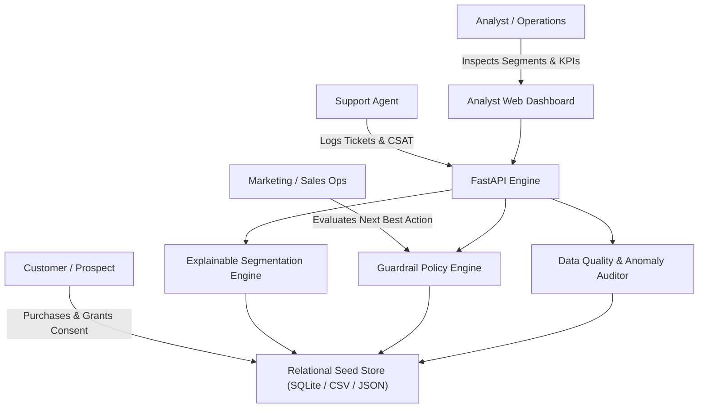
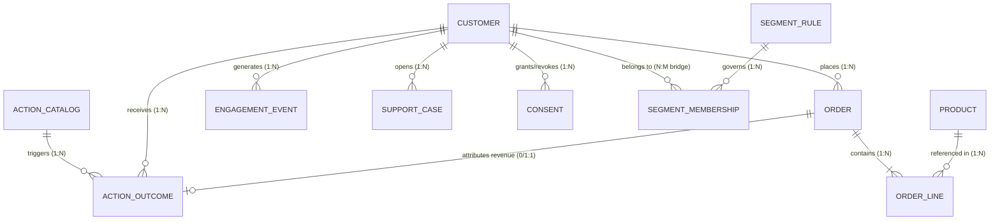
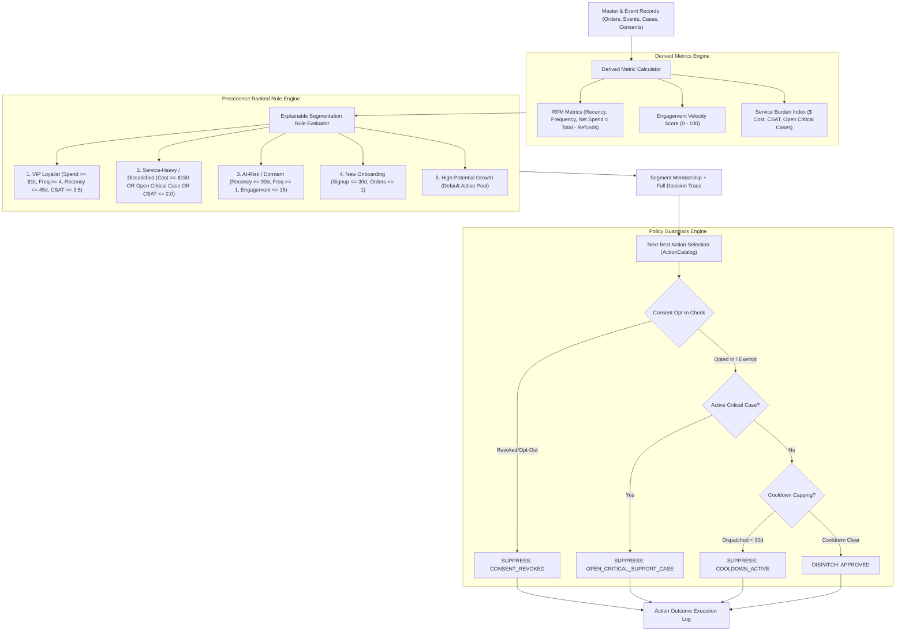

# Technical Architecture & System Design Document

**Role:** Associate AI Forward Deployed Engineer  
**Organization:** YottaFlex AI Recruitment Drive  
**System Name:** Explainable Customer Segmentation & Action Intelligence Platform  

---

## 1. Executive Summary & Problem Context
Modern commercial organizations possess vast amounts of multi-channel customer data: transaction records, web/app engagement telemetry, and support tickets. However, legacy segmentation typically suffers from:
1. **Opaque Black-Box Classifications:** Sales and support agents do not understand why a customer is placed in a given tier.
2. **Policy & Consent Breaches:** Dispatches occur despite revoked user privacy preferences or during severe customer service friction.
3. **Data Quality Drift & Non-Reproducibility:** Mismatched net revenue arithmetic (failing to net refunds) and untraceable anomaly corruptions.

This system provides a deterministic, transparent, and auditable end-to-end Forward Deployed AI architecture solving these issues with full provenance, explicit decision traces, and 100% reproducible data generation.

---

## 2. Primary Actors & Systems

### Actor Responsibilities:
1. **Customer / Prospect:** Generates master account profiles, purchases products, records multi-channel clickstream events, logs support tickets, and manages privacy consent statuses.
2. **Marketing / Sales Operations:** Defines campaign actions in the `ActionCatalog`, checks target segments, and monitors dispatch delivery vs. suppression metrics.
3. **Support Agent:** Handles customer tickets, updates CSAT scores, and logs service costs. High friction tickets automatically inform the policy engine to suppress aggressive marketing.
4. **Analyst:** Inspects the 360-degree customer view, audits step-by-step rule evaluation traces, and monitors segment migration.
5. **System Administrator:** Executes data generation pipelines, triggers validation audits, and verifies reproducibility via cryptographic hashes.

---

## 3. Entity Relational Architecture (11 Core Entities)

### Deterministic Identifier Format:
- `Customer`: `CUS-000001`
- `Product`: `PRD-000001`
- `Order`: `ORD-YYYY-000001`
- `OrderLine`: `LIN-ORD-YYYY-000001-NN`
- `EngagementEvent`: `ENG-YYYY-000001`
- `SupportCase`: `CAS-YYYY-000001`
- `Consent`: `CON-YYYY-000001`
- `SegmentRule`: `SEG-YYYY-000001`
- `SegmentMembership`: `MEM-SEG-YYYY-000001-CUS-000001`
- `ActionCatalog`: `ACTN-YYYY-000001`
- `ActionOutcome`: `OUT-YYYY-000001`

---

## 4. End-to-End Decision Pipeline

---

## 5. Deliberate Anomaly Injection & Zero-Leakage Ground Truth
In accordance with Step 5 and Step 7, four deliberate edge cases are injected into baseline data to evaluate real-world monitoring:
1. `conflicting_exclusive_segments`: Customer concurrently assigned to both `VIP_LOYALIST` and `AT_RISK_DORMANT`.
2. `action_violates_consent`: Dispatched commercial action marked `DELIVERED` despite `EMAIL_MARKETING` consent being `REVOKED` or `OPTED_OUT`.
3. `return_not_netted_from_spend`: Order has refund recorded, but `net_amount` improperly calculated as equal to gross `total_amount`.
4. `outcome_attributed_to_wrong_action`: Conversion revenue misattributed to an unrelated campaign action.

**Zero-Leakage Assurance:**
All injected discrepancies are logged exclusively to `ground_truth.json` / `ground_truth.csv`. The runtime segmentation and policy engines have zero knowledge of these labels. Detection algorithms in `src/validation/auditor.py` identify anomalies purely via mathematical checks and relational rule audits.

---

## 6. Validation & Reproducibility Benchmark Results
The system demonstrates **100% Precision, Recall, and F1-Score**:

| Anomaly Category | True Positives | False Positives | False Negatives | Precision | Recall | F1-Score | Status |
|:---|:---:|:---:|:---:|:---:|:---:|:---:|:---:|
| `conflicting_exclusive_segments` | 5 | 0 | 0 | 100.0% | 100.0% | 100.0% | PASS |
| `action_violates_consent` | 5 | 0 | 0 | 100.0% | 100.0% | 100.0% | PASS |
| `return_not_netted_from_spend` | 5 | 0 | 0 | 100.0% | 100.0% | 100.0% | PASS |
| `outcome_attributed_to_wrong_action` | 5 | 0 | 0 | 100.0% | 100.0% | 100.0% | PASS |
| **Overall Benchmark** | **20** | **0** | **0** | **100.0%** | **100.0%** | **100.0%** | **PERFECT** |

### Step 10 Cryptographic Hash Reproducibility:
Two separate generation runs with fixed seed `20261022` yield identical SHA-256 hashes across all 11 tables and ground truth.

---

## 7. Architectural Trade-offs & Engineering Decisions
1. **Rule-Based Engine vs. Black-Box Machine Learning:**
   - *Decision:* Implemented transparent, priority-ranked decision trees with natural language string interpolation rather than an unexplainable random forest or neural net.
   - *Rationale:* Forward deployed engineering mandates that every decision can be audited by business analysts, compliance officers, and support teams with unambiguous justification.
2. **Explicit Consent & Event State Changes vs. Row Mutation:**
   - *Decision:* State changes (e.g. consent revocation, returns, support escalations) are preserved as distinct event timestamps and ledger records rather than overwriting historical transactions.
3. **Dual Scale Architecture (Starter vs Full Scale):**
   - *Decision:* Parameterized generator architecture supporting instant starter sample mode (< 3 seconds) and full production scale (50,000 customers, 200,000 orders, 1,000,000 events) using the same deterministic algorithms.
